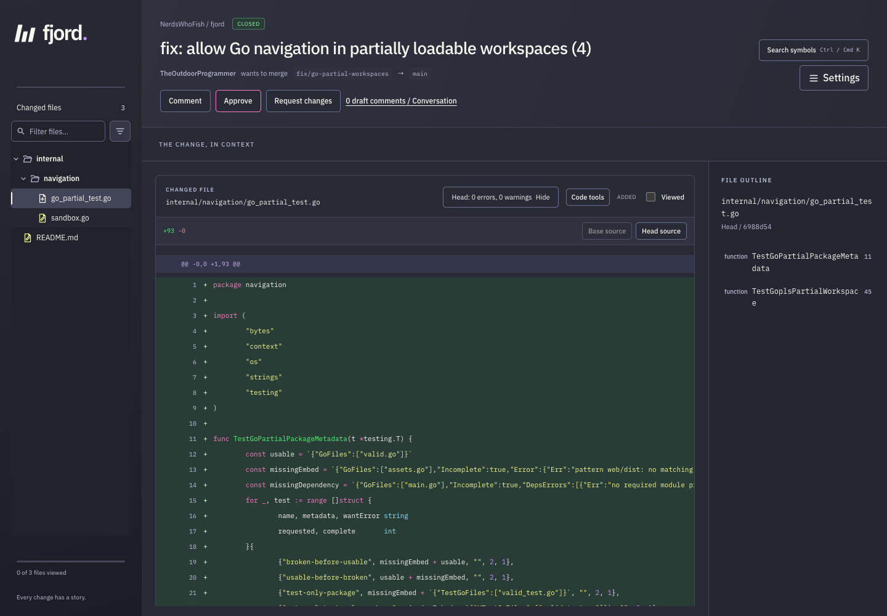
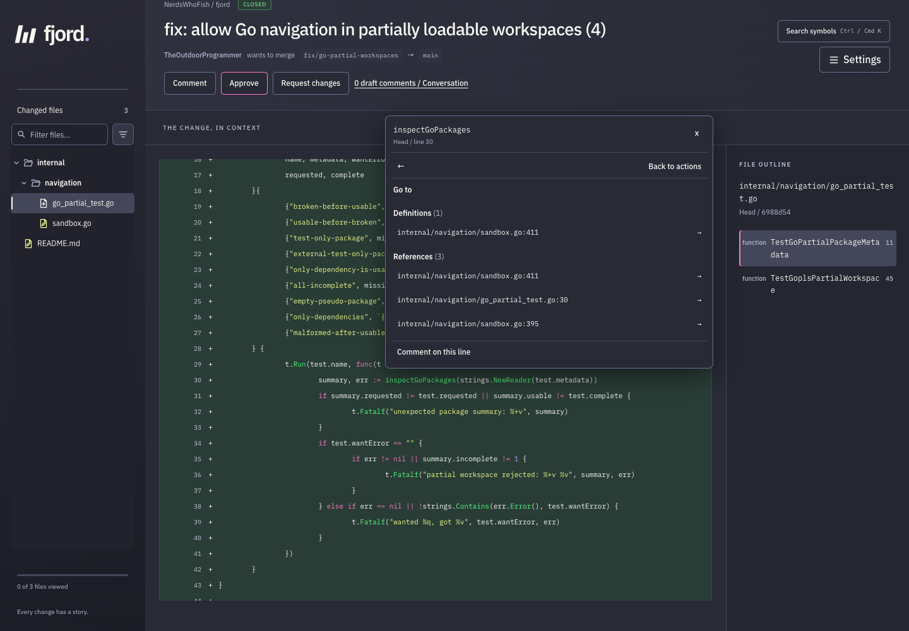
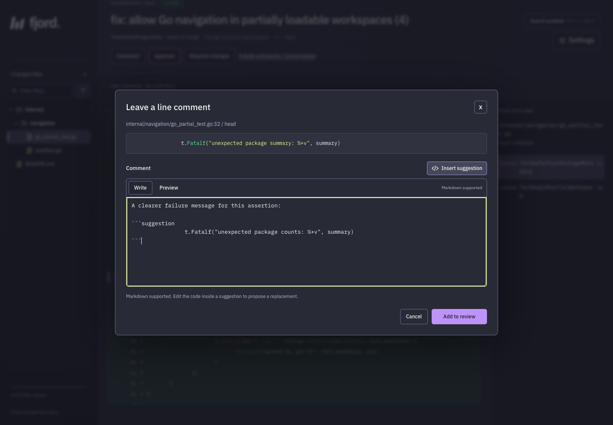

# Fjord

A GitHub PR review UI with language-server navigation. Follow the code, leave comments, and submit your review without losing your place.



## What you get

- Unified or split diffs, expandable context, inline threads, and multiline suggestions.
- Definitions and references in one **Go to** menu, plus implementations, call hierarchies, diagnostics, and symbol search.
- GitHub review decisions, Markdown previews, and Light, Dark, and Dracula themes.
- Bundled language servers for Go, Terraform/OpenTofu, JS/TS, Python, YAML, JSON, Bash, Dockerfiles, HTML, and CSS/SCSS.
- Offline Kubernetes, GitHub Actions, and TypeScript configuration schemas. Bring your own servers or connect an AI client through MCP.

## Quick start

Install **Go 1.27.3+**, **Node.js 22.22.2+**, and the **GitHub CLI**.
Use macOS with `sandbox-exec`, or Linux with Bubblewrap and unprivileged user namespaces enabled.

```sh
git clone https://github.com/NerdsWhoFish/fjord.git
cd fjord
gh auth login --hostname github.com

GOBIN="$PWD/bin" sh scripts/install-language-servers.sh
sh scripts/install-node-language-servers.sh
export PATH="$PWD/bin:$PATH"
export FJORD_LANGUAGE_BUNDLE="$PWD/languages"

make build
./bin/fjord
```

Open <http://127.0.0.1:4727> and paste a PR URL. Homebrew Node installations may need [additional runtime paths](docs/configuration.md#native-node-runtimes).

For another device on your trusted LAN:

```sh
./bin/fjord -addr 0.0.0.0:4727 -host 192.168.1.10
```

Replace the IP with your server's address. **There is no application login; everyone connected uses the server's GitHub identity.**

## Review a PR

1. Paste a GitHub PR URL, or open `http://127.0.0.1:4727/owner/repo/123`.
2. Pick a file or scroll through the diff. Hover or click a symbol, then choose **Go to**.
3. Click a line number, or drag across several, to comment. Use **Insert suggestion** for replacement code.
4. Choose **Add to review**, then **Comment**, **Approve**, or **Request changes** under the PR title. Check the summary and submit; Fjord returns you to GitHub.
5. Use **Settings** for themes and split/unified diffs. Search workspace symbols with **Ctrl/Cmd+K**.

### Follow symbols

Definitions appear above references. Open any result in the source pane, including unchanged files.



### Suggest changes

Select code, write Markdown, and preview a suggestion before adding it to your review.



## More

- [Configuration and deployment](docs/configuration.md): containers, reverse proxies, private Go dependencies, BYO servers, and troubleshooting.
- [MCP setup](docs/configuration.md#mcp-assistance): connect your AI client to `http://127.0.0.1:4727/mcp`. AI changes remain drafts for you to review.
- [Chrome extension](extension/README.md): redirect GitHub's changes page to `fjord.stout.zone`.
- [Release packaging](docs/releases.md) and [language-server bundle](languages/README.md).

Development: `make check` runs the full checks with installed language servers. [Architecture decisions](adr/README.md). [MIT license](LICENSE).
